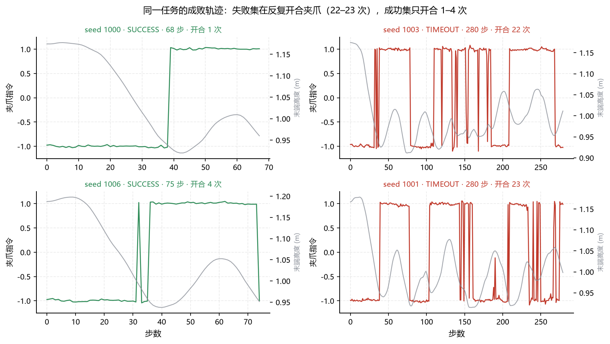
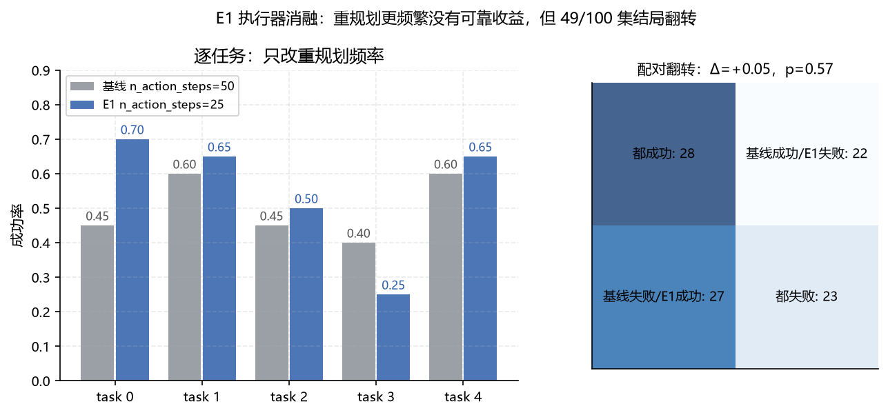
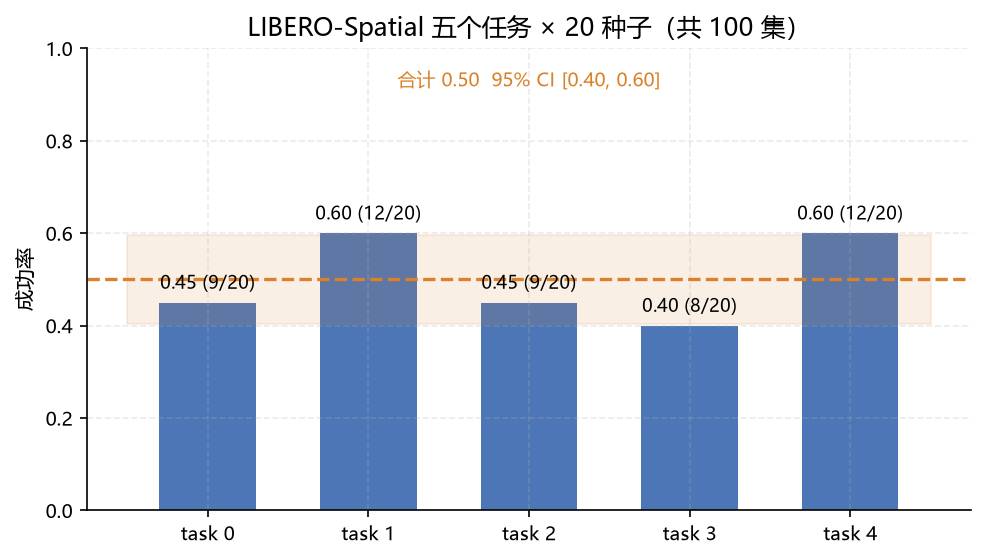
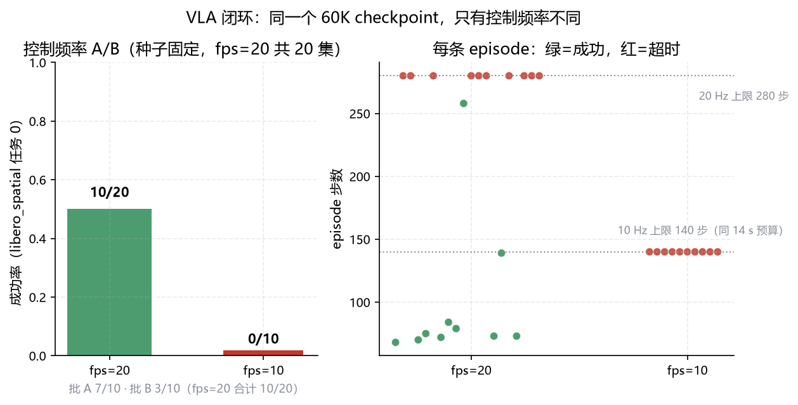
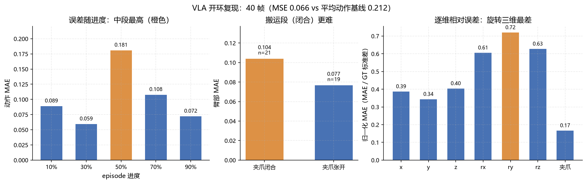
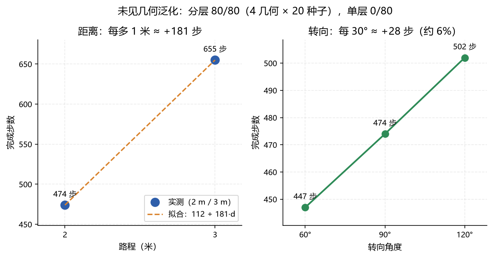
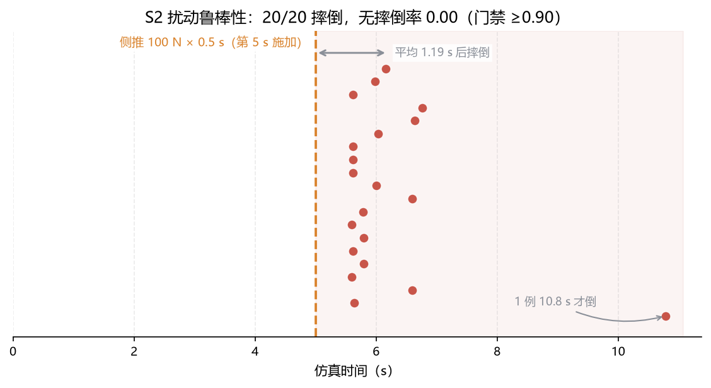
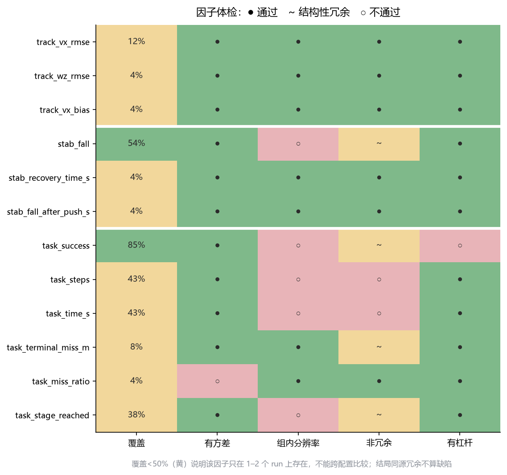
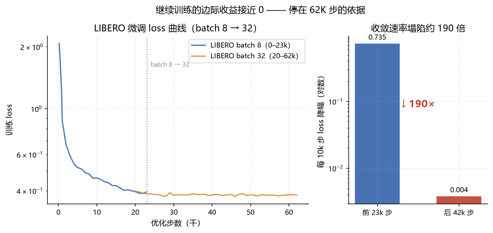

# 结果总表（单一事实源）

本文件是**唯一权威的结果清单**。表格里每个数字都能在 [`reports/evidence/`](../reports/evidence/)
找到对应的原始 JSON；`logs/`（训练/评测的工作目录）**不入库**，所以可验证的证据一律以
`reports/evidence/` 下的副本为准。

- 最后更新：2026-11-15
- 判据来源：[EXPERIMENT_DESIGN.md](EXPERIMENT_DESIGN.md)（2026-10-22 预注册，v1.0）
- 状态含义：✅ 过门槛 / ❌ 未过门槛（负结果，留档）/ 🚧 未完成 / ❓ 未测

---

## 一、机器狗（Isaac Lab → MuJoCo）四条线

| # | 实验 | 判据（预注册） | 结果 | 状态 | 证据 |
|---|---|---|---|---|---|
| 1 | **L3 分层 vs 单层 A/B**（3 训练种子 × 20 冻结种子） | 分层成功率 > 单层 | 分层 3/3 种子 100%（100 迭代收敛）；单层 1/3（450 迭代），2 种子 1500 迭代全败 | ✅ | [EXPERIMENTS.md](EXPERIMENTS.md)、[reports/training/](../reports/training/) |
| 2 | **S4 速度跟踪**（Isaac 策略零改动 → MuJoCo） | `vx_rmse ≤ 0.15` | **0.0773 ± 0.0285**（20 种子）；wz_rmse 0.1391 ± 0.0691；fall 0.05 | ✅ | [`velocity_s0.json`](../reports/evidence/s4-sim2sim-2026-11-13/velocity_s0.json) |
| 3 | **S4 四阶段序列（分层）** | 成功率 `≥ 0.90` | **20/20 = 1.00**；平均 474 步；4 阶段到达率均 1.0；fall 0 | ✅ | [`sequence_layered.json`](../reports/evidence/s4-sim2sim-2026-11-13/sequence_layered.json) |
| 4 | **S4 四阶段序列（单层）** | 失败模式与 Isaac 一致 | **0/20**；fall 1.0 | ❌（预期内） | [`sequence_single.json`](../reports/evidence/s4-sim2sim-2026-11-13/sequence_single.json) |
| 5 | **未见几何泛化（分层）** | 成功率 `≥ 0.90` | **80/80 = 1.00**（4 几何 × 20 种子） | ✅ | [`generalization_and_s2.json`](../reports/evidence/m2-campaign-2026-11-14/generalization_and_s2.json) |
| 6 | **未见几何泛化（单层）** | 对照 | **0/80**；各变体 fall 1.0 | ❌（预期内） | 同上 |
| 7 | **S2 扰动鲁棒性** | `no_fall_rate ≥ 0.90` | **0/20**；侧推 100 N × 0.5 s（第 5 秒施加）；fall 1.0。**C0 脚本基线在同一推力下同样 0/20**（recovery 0.48 s） | ❌ | 同上 |
| 8 | **C0 脚本小跑基线（RQ2 下界）** | 与 RL 同任务同指标 | 无推力：vx_rmse **0.6064**，fall 0；同一 100 N 推力：vx_rmse 0.5759，**no-fall 0/20** | ✅（下界已量化） | [`c0_baseline.json`](../reports/evidence/m2-campaign-2026-11-14/c0_baseline.json) |
| 9 | **ROS2 真 DDS 闭环**（ROS-R1） | 独立探针验证指令→状态 | `ROS2_ROUNDTRIP_PASS`；clock/joint_states/base_pose/tf 各 **582** 条；TF 校验通过；前进 **1.238 m**；转向 **+1.585 rad**；接受 187 条指令 | ✅ | [`probe_receipt.json`](../reports/evidence/ros2-r1-2026-11-13/probe_receipt.json) |

泛化矩阵的逐变体分解：

| 几何 | 是否训练时见过 | 分层成功率 | 完成步数 | 单层成功率 |
|---|---|---|---|---|
| 2 m / 90° | 见过 | 1.00 | 474 | 0.00 |
| 3 m / 90° | **未见过** | 1.00 | 655 | 0.00 |
| 2 m / 60° | **未见过** | 1.00 | 447 | 0.00 |
| 2 m / 120° | **未见过** | 1.00 | 502 | 0.00 |

**RQ2 对照**：脚本小跑 0.6064 → RL 0.0773，误差降低 **7.8×**。

---

## 二、VLA 线（SmolVLA 450M）

| # | 实验 | 规模 | 结果 | 状态 |
|---|---|---|---|---|
| 10 | 官方真机教师数据微调 | `lerobot/svla_so101_pickplace`，20 000 步，batch 8 | final loss **0.112**（41 分钟，4.95 step/s） | ✅ |
| 11 | 跨域评测（真机策略 → 仿真孪生） | **n = 1 episode**，3 600 步 | 放置 **0/4** 个方块 | ❌（样本量 1，仅作定性） |
| 12 | LIBERO 自洽微调 | `lerobot/libero`（1 693 段 / 273 465 帧 / **10 Hz** / 256×256 / state 8 / action 7），batch 32 × accum 2 | 62 000 / 100 000 步，loss **0.380**（20K 时 0.394），lr 已退火至 2.5e-6 | 🚧 中断 |
| 13 | **开环复现检查**（60K checkpoint） | 40 帧（8 段 × 5 帧，覆盖 10%–90% 进度） | MSE **0.0656** vs 平均动作基线 0.2117（**比值 0.31**）；七维相关 +0.82/+0.91/+0.78/+0.64/+0.58/+0.58/+0.85；夹爪符号一致 **0.93**；遮图后动作偏移 L2 **0.489** | ✅ 模型已学会 |
| 14 | **LIBERO 闭环成功率（fps = 20，种子固定）** | `libero_spatial` **5 个任务 × 20 种子 = 100 集**，14 s 预算 | **50/100 = 0.50**（95% CI **0.40–0.60**）；逐任务 0.40–0.60（9/20、12/20、9/20、8/20、12/20） | ✅ 权威数字 |
| 15 | **控制频率 A/B** | 同任务、同种子 | **fps=20 → 0.50（10/20）；fps=10 → 0.00（0/10，全部超时）** → 数据集元数据 `fps=10` **不是**控制契约 | ✅ |
| 16 | **测量波动（必须记录）** | 同一 checkpoint、同一 10 个种子 | 未固定策略种子时单批为 **7/10**；固定种子后两批为 **7/10、3/10**。逐种子不保证可复现（seed 1003：70 步成功 vs 280 步超时）→ 单批数字不可外推 | ⚠️ 方法学 |
| 18 | **E1 执行器消融**（`n_action_steps` 50 → 25，不重训） | 100 个 task-seed 配对 | **55/100 vs 50/100**，Δ **+0.05**（95% CI −0.09~+0.19），McNemar **p = 0.57**；27 改善 / 22 恶化 / **49 集结局翻转** | ❌ 无可靠收益 |
| 17 | **评测耗时分解与并行** | 单集 280 步 | `env.step` **111.8 ms/步**（物理子步主导，渲染分辨率 360→224 几乎无影响）；单集 34.4 s。2 进程 → **14.8 s/集（2.3×）**；4 进程在 WSL/EGL 下跑到第 4 集即卡死，6 进程被 OOM 杀 | 🔧 工程 |

开环检查的含义：策略在训练帧上能复现演示动作、依赖视觉、夹爪时机正确 →
**"模型没学会"已被排除**；剩余嫌疑转向评测链路（见下）。

证据：[`libero_suite_5tasks.json`](../reports/evidence/vla-2026-11-15/libero_suite_5tasks.json)、
[`openloop_060k.json`](../reports/evidence/vla-2026-11-15/openloop_060k.json)、
[`libero_seeded_a.json`](../reports/evidence/vla-2026-11-15/libero_seeded_a.json)、
[`libero_seeded_b.json`](../reports/evidence/vla-2026-11-15/libero_seeded_b.json)、
[`libero_ab_fps10_n10.json`](../reports/evidence/vla-2026-11-15/libero_ab_fps10_n10.json)

> **2026-11-15 关键修复**：闭环评测此前一直把 robosuite 的原始观测（uint8 HWC，
> 带 batch 维 `(1,360,360,3)`，任务为元组）直接喂给按 float32 CHW `[0,1]` 训练的模型。
> 统一观测契约后，同一个 60K checkpoint 从 **0/3** 变为有非零成功率。
>
> **关于 0.50 这个数字**：单批 10 集曾给出 7/10，但第二批复现实验只有 3/10，合并 20 集为
> **10/20**。策略的动作由 flow matching 采样，逐种子不保证跨运行一致（GPU 数值非确定性
> 会在闭环里被放大），因此**单批数字不可外推**，表中以 20 集合并值为准。因子表见
> [`docs/FACTORS.md`](FACTORS.md) 的 `vla_closed_*` 与 `vla_control_freq_ratio`。

---

## 三、已知未解问题

| 问题 | 现状 | 下一步 |
|---|---|---|
| **观测契约（已修复）** | 评测曾把 uint8 HWC `(1,360,360,3)` 图像与元组任务字符串直接喂给按 float CHW `[0,1]` 训练的模型 → 结构性 0 成功率 | 已在 `vla/evaluate_libero.py` 统一：uint8→float、HWC→CHW、去 batch 维、元组→字符串 |
| VLA 结果覆盖面窄 | 仅 `libero_spatial` 任务 0 × 10 episodes（0.70） | 扩到多任务（≥5 任务 × 10 episodes）再对外报数 |
| 控制频率非默认值 | 实测 `fps=20` 有效、`fps=10` 全败；数据集元数据写的是 10 | 已在因子表记录 `vla_control_freq_ratio = 2.0`；后续配置固定 20 |
| S2 扰动门禁未过 | 训练时未启用推力 DR；根因已定位 | 加推力 DR 重训 3 种子（需 Isaac Lab） |
| 单层策略全败 | 与 Isaac 侧结论一致（步态切换处失败） | 不作为缺陷，作为对照 |
| 教师数据跨域仅 1 个 episode | `logs/vla/eval_run6.log` 只有 episode 0 | 若要下结论需补足 episode 数 |
| 序列任务指标退化 | 完成步数方差 0、终点残差恒 0.23 m（容差 0.30 m） | 补分段耗时/超调/终点收敛精度等连续指标 |
| **执行层调频率已排除** | E1（50→25）配对 p=0.57、翻转率 49%；但成功集快了 9.6 步 | 若只关心成功率，频率不是杠杆；若关心效率，它有效 |
| **夹爪抖动假设（待验证）** | 2 条失败轨迹均反复开合 22–23 次，成功仅 1–4 次 | 加"夹爪状态锁存"（闭合且抬升后不允许随意重开）做 A/B，成本极低 |

---

## 四、图表（`media/analysis/`，由证据直接生成）

全部由 `python scripts/make_factor_charts.py` 从 `reports/evidence/` 与
`reports/analysis/` 的原始数据重绘，不手填数字。

### VLA 证据视频

| 视频 | 内容 |
| --- | --- |
| [`libero_quad.mp4`](../media/training/libero_quad.mp4) | 2×2：2 条成功（seed 1000/1006）与 2 条超时（seed 1003/1001），每格标注 seed/结局/步数 |
| [`libero_dual.mp4`](../media/training/libero_dual.mp4) | 前视 + 腕部双视角，底部同步夹爪指令曲线（−1 张开 → +1 闭合）与实时末端高度 |

### 失败归因（只使用已有数据，未跑新评测）

数据源：100 对配对结果（基线 vs E1）＋ 4 条带逐步轨迹的 episode（2 成 2 败）。

| 分析 | 结果 |
|---|---|
| 配对稳定性 | **总是成功 28 / 总是失败 23 / 翻转 49**（27 变好、22 变坏） |
| 逐任务稳定失败数 | task 0: 4、task 1: 2、task 2: 5、**task 3: 8**、task 4: 4 |
| 逐任务翻转数 | 9 / 11 / 11 / 11 / 7（task 1–3 有一半以上结局不稳定） |
| 成功集耗时 | 基线 111.5 步 → E1 **101.9 步（−9.6 步，约 −8.6%）** |

带轨迹的 4 集（同一任务）：

| seed | 结局 | 步数 | 夹爪开合次数 | 闭合后抬升 |
|---|---|---|---|---|
| 1000 | 成功 | 68 | **1** | 0.077 m |
| 1006 | 成功 | 75 | **4** | 0.061 m |
| 1003 | 超时 | 280 | **22** | 0.091 m |
| 1001 | 超时 | 280 | **23** | 0.131 m |



**结论（n=2 条失败轨迹，仅 task 0，属初判）**：
两次失败都**成功抓起并抬升了物体**（0.09 / 0.13 m），说明失败**不在接近或抓取**，而在搬运/放置阶段；
失败轨迹的特征是**夹爪反复开合（22–23 次）**、末端高度来回起落，而成功轨迹只开合 1–4 次。
→ 可检验假设：**夹爪指令抖动/反复重抓**是主要失效模式，而不是"抓不到"。

### E1：只改重规划频率



`n_action_steps` 50 → 25（预测仍是 50 步，只执行前 25 步就重新观察）：净值 +5 个百分点，
但配对检验 p = 0.57，且 **49/100 集结局翻转**（27 好、22 坏）——说明结果由噪声主导，
"重规划更频繁"不是有效杠杆。

### LIBERO-Spatial 五任务成功率



5 任务 × 20 种子 = 100 集，合计 **0.50**（95% CI 0.40–0.60），任务间 0.40–0.60。

### VLA 闭环：控制频率 A/B



同一个 60K checkpoint、同一任务、同一批种子：`fps=20` **7/10**，`fps=10` **0/10**（全部卡在 140 步上限）。

### VLA 开环误差分解



误差不随进度单调增长，**中段（夹爪闭合、正在搬运）最高**（0.181，是前后段两倍）；
逐维看，旋转三轴的归一化误差最大（0.61–0.72），因为该方向 GT 本身幅值很小。

### 泛化几何成本



距离贵：每多 1 米 ≈ **+181 步**（固定开销 112 步）；转向便宜：每 30° ≈ **+28 步**（约 6%）。

### S2 扰动失效时间窗



20/20 摔倒，全部发生在侧推后 **1.19 s** 内；1 例异常晚倒（10.8 s，已在图中标注）。

### 因子体检



12 个 rollout 因子的覆盖/方差/组内分辨率/冗余/杠杆状态；黄色覆盖表示该因子只在 1–2 个
run 上存在，不能跨配置比较。

### 训练收敛塌陷



前 23k 步每 10k 步 loss 降 0.735，后 42k 步只降 0.0038（**约 190 倍衰减**）——停在 62K 步的依据。

---

## 五、复现命令

```bash
# 开环复现检查（WSL vla-env，离线可跑）
HF_HUB_OFFLINE=1 python vla/openloop_check.py \
    --checkpoint logs/vla/libero_smolvla/checkpoints/060000/pretrained_model \
    --dataset-root /root/.cache/huggingface/lerobot/hub/datasets--lerobot--libero/snapshots/a1aaacb7f6cd6ee5fb43120f673cebb0cfea7dd4 \
    --episodes 8 --frames-per-episode 5

# S4 评测（Windows .venv312）
.venv312\Scripts\python.exe scripts\eval_s4_sim2sim.py --task velocity --policy s0_flat
.venv312\Scripts\python.exe scripts\eval_s4_sim2sim.py --task sequence --policy layered --label layered_B
```

> 注：`logs/` 与模型权重不入库。需要重跑时按 `run_config.json` 里的命令与环境版本重建；
> `reports/evidence/` 下的 JSON 是评测输出的原样副本（未改动数值）。
